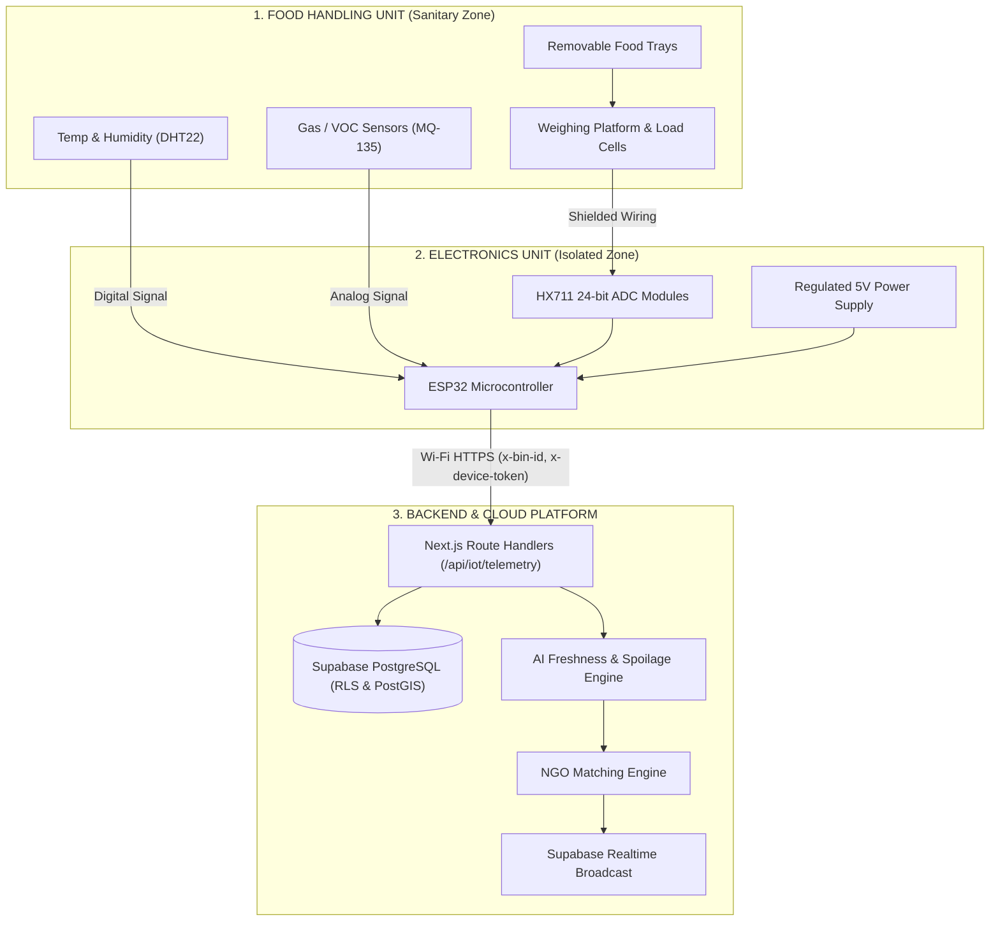
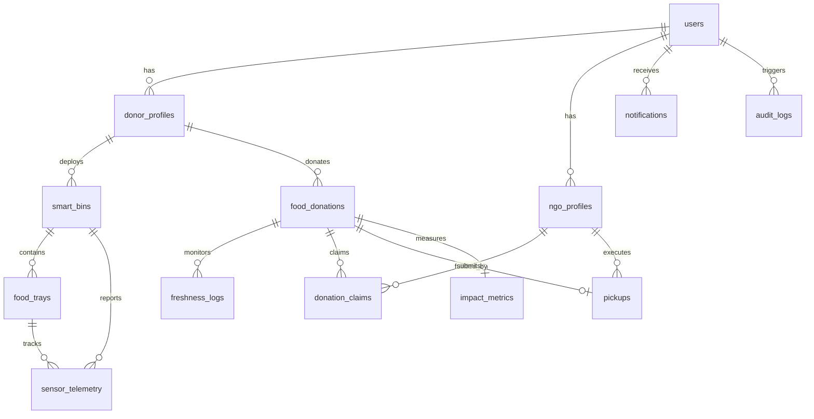

# 🏗️ System Architecture & Backend Specification
## AI + IoT Smart Food Waste Monitoring & Redistribution System (FoodTrust)

**Author:** Lead Backend Architect  
**Version:** 1.0.0-PROPOSAL  
**Target Environment:** Next.js (App Router) + TypeScript + Supabase (PostgreSQL, Auth, Realtime, Storage)

---

## 1. System Overview & Physical Hardware Architecture

The **FoodTrust** system continuously monitors surplus edible food using IoT-enabled smart bins installed at donor premises (restaurants, cafeterias, hotels, banquet halls). 

### 1.1 Physical Hardware Architecture (Two Separated Modules)

To comply with food hygiene standards, prevent bacterial contamination, protect sensitive electronics from moisture/cleaning chemicals, and ensure fire safety, the physical bin is strictly divided into two physically isolated modules:

```
┌────────────────────────────────────────────────────────────────────────┐
│                   SMART BIN PHYSICAL ARCHITECTURE                      │
├────────────────────────────────────────────────────────────────────────┤
│ 1. FOOD HANDLING UNIT (Sanitary Food Contact Zone)                    │
│    ├── Removable Food Trays (Food-grade stainless steel/polycarbonate)  │
│    ├── Tray Weighing Platforms with mechanical overload protection     │
│    ├── Load Cells (4-wire strain gauges mounted below platforms)       │
│    ├── Temperature & Relative Humidity Sensor (DHT22/SHT31, sealed)     │
│    └── Gas / VOC Sensors (MQ-135 / BME680 for spoilage metabolites)    │
│                                                                        │
│    ═══════════ PHYSICAL BARRIER / HERMETIC PASS-THROUGH ════════════   │
│                 (Moisture-sealed, food-grade wiring grommets)          │
│                                                                        │
│ 2. ELECTRONICS UNIT (Isolated Electrical / Telemetry Zone)             │
│    ├── HX711 24-bit ADC Signal Amplifier Modules (one per tray/cell)  │
│    ├── ESP32 Microcontroller (Dual-core, Wi-Fi 802.11 b/g/n, BLE)      │
│    ├── Power Supply Module (Regulated 5V/3.3V DC, Surge & Fuse Prot.)  │
│    ├── Status Indicator LEDs / Buzzer (Calibration & Connection State) │
│    └── Communication & Wiring Harness                                  │
└────────────────────────────────────────────────────────────────────────┘
```

- **Food Handling Unit:** Contains only the removable food trays and sealed sensors directly required inside the food preservation chamber. All surfaces are washable and food-safe.
- **Electronics Unit:** Completely separated in an exterior or sealed lower compartment. Food and electronics never make physical contact.
- **Communication:** The ESP32 processes analog sensor readings from the HX711 and environmental sensors, applies edge calibration/taring, and transmits telemetry packets over Wi-Fi to the Next.js API via HTTPS.



---

## 2. Current State Assessment & Coexistence Strategy

### 2.1 Repository Inspection Findings
- The current repository ([`FoodTrust`](file:///C:/Users/DELL/final_year_project/FoodTrust)) is a clean static multi-page prototype consisting of HTML views (`index.html`, `donor-dashboard.html`, `nearby-donations.html`, `admin-dashboard.html`, etc.), CSS (`CSS/style.css`), client-side scripts (`js/script.js`), and media assets (`assets/logo2.png`).
- **No Next.js project currently exists** in the repository (no `package.json`, `tsconfig.json`, or Next.js directory structure).

### 2.2 Non-Destructive Coexistence Plan
To ensure **zero risk of overwriting or breaking existing frontend code**:
1. **Next.js Project Integration:** Next.js will be initialized with TypeScript and the App Router (`app/`).
2. **Asset Preservation:** The existing frontend (`*.html`, `CSS/`, `js/`, `assets/`) is preserved directly in the project. The static files can be served via Next.js `public/` directory or directly alongside Next.js.
3. **API Decoupling:** All backend logic resides exclusively under `app/api/...` (REST endpoints) and `lib/` (business domain services).
4. **Seamless Frontend Upgrade:** Existing client-side fetch calls in `js/script.js` can directly consume `http://localhost:3000/api/...`, allowing the current UI to become live immediately without needing a complete rewrite.

---

## 3. Proposed Directory Structure

```
FoodTrust/
├── ARCHITECTURE.md                  # This master architecture document
├── README.md                        # Documentation
├── package.json                     # Dependencies & scripts
├── tsconfig.json                    # TypeScript compiler configuration
├── next.config.ts                   # Next.js configuration
├── .env.example                     # Sample environment configuration
├── .env.local                       # Local secret keys (Git-ignored)
├── public/                          # Static assets and existing frontend views
│   ├── assets/                      # Brand images, icons (logo2.png)
│   ├── CSS/                         # Existing style.css
│   ├── js/                          # Existing client-side script.js
│   ├── index.html                   # Preserved Homepage
│   ├── donor-dashboard.html         # Preserved Donor UI
│   ├── nearby-donations.html        # Preserved NGO UI
│   ├── admin-dashboard.html         # Preserved Admin UI
│   └── ...                          # All existing static views
├── app/                             # Next.js 14/15 App Router
│   ├── layout.tsx                   # Root HTML wrapper
│   ├── page.tsx                     # Optional Next.js entrypoint (redirects to UI)
│   └── api/                         # REST API Route Handlers
│       ├── auth/
│       │   ├── register/route.ts    # POST: Register user (Donor/NGO)
│       │   ├── login/route.ts       # POST: Authenticate user & issue session
│       │   ├── logout/route.ts      # POST: Revoke session
│       │   └── me/route.ts          # GET: Fetch authenticated profile & role
│       ├── donors/
│       │   ├── route.ts             # GET (list/filter), POST (create profile)
│       │   └── [id]/route.ts        # GET, PATCH (update profile)
│       ├── ngos/
│       │   ├── route.ts             # GET (list verified NGOs), POST (create)
│       │   ├── verify/route.ts      # POST: Admin verification/approval
│       │   └── [id]/route.ts        # GET, PATCH
│       ├── iot/
│       │   ├── bins/
│       │   │   ├── route.ts         # GET (all bins), POST (register new bin)
│       │   │   └── [id]/route.ts    # GET, PATCH (calibration parameters)
│       │   ├── trays/
│       │   │   ├── route.ts         # GET, POST (configure tray category)
│       │   │   └── [id]/route.ts    # GET, PATCH
│       │   ├── telemetry/route.ts   # POST: High-throughput ingestion from ESP32
│       │   └── heartbeat/route.ts   # POST: Device health & online status ping
│       ├── donations/
│       │   ├── route.ts             # GET (active donations), POST (manual submit)
│       │   ├── [id]/
│       │   │   ├── route.ts         # GET donation details, PATCH
│       │   │   ├── claim/route.ts   # POST: NGO claim / accept endpoint
│       │   │   └── freshness/route.ts # GET: Recalculate dynamic freshness
│       │   └── match/route.ts       # POST: Trigger matching algorithm
│       ├── pickups/
│       │   ├── route.ts             # GET (assigned pickups), POST (schedule)
│       │   ├── [id]/route.ts        # GET pickup status, PATCH
│       │   ├── generate-otp/route.ts# POST: Generate handoff OTP for donor
│       │   ├── verify-otp/route.ts  # POST: NGO volunteer verification on pickup
│       │   └── complete/route.ts    # POST: Delivery confirmation & photo upload
│       ├── notifications/
│       │   ├── route.ts             # GET user notifications
│       │   └── [id]/read/route.ts   # PATCH: Mark notification as read
│       ├── analytics/
│       │   ├── overview/route.ts    # GET: High-level impact KPIs
│       │   ├── donor/route.ts       # GET: Donor-specific analytics
│       │   ├── ngo/route.ts         # GET: NGO-specific food intake metrics
│       │   └── admin/route.ts       # GET: Admin system-wide trends
│       └── admin/
│           ├── users/route.ts       # GET, PATCH (block/unblock/delete)
│           ├── logs/route.ts        # GET: Audit trail logs
│           └── config/route.ts      # GET, PATCH: System thresholds & params
├── lib/                             # Core Backend Services & Business Logic
│   ├── supabase/
│   │   ├── client.ts                # Client-safe Supabase instance
│   │   ├── server.ts                # Server-side Supabase client (respects RLS)
│   │   └── admin.ts                 # Service Role Supabase client (bypasses RLS for workers)
│   ├── auth/
│   │   ├── rbac.ts                  # Role-based middleware & guard decorators
│   │   ├── device-auth.ts           # HMAC / SHA-256 device key validator for ESP32
│   │   └── session.ts               # Session & token parser
│   ├── validation/                  # Zod validation schemas
│   │   ├── auth.schema.ts           # Login/Register validation
│   │   ├── iot.schema.ts            # Sensor telemetry & smart bin validation
│   │   ├── donation.schema.ts       # Donation creation & claim validation
│   │   ├── pickup.schema.ts         # OTP & pickup lifecycle validation
│   │   └── admin.schema.ts          # Configuration & audit schemas
│   ├── services/                    # Pure Domain Services
│   │   ├── freshness.service.ts     # Spoilage decay model (Thermal degree-hours + VOC)
│   │   ├── matching.service.ts      # Multi-criteria NGO matching engine (PostGIS / Haversine)
│   │   ├── iot.service.ts           # Ingestion, threshold filtering, tray aggregation
│   │   ├── pickup.service.ts        # OTP generation, status state machine
│   │   ├── notification.service.ts  # Supabase Realtime broadcast & notification dispatcher
│   │   └── audit.service.ts         # Centralized immutable audit logger
│   └── utils/
│       ├── api-response.ts          # Uniform JSON response envelope `{ success, data, error }`
│       ├── geo.ts                   # Geospatial calculation utilities
│       └── error-handler.ts         # Standard HTTP error wrapper (400, 401, 403, 404, 500)
├── types/                           # TypeScript Interfaces & Database Schema Types
│   ├── database.types.ts            # Supabase auto-generated database typings
│   ├── api.types.ts                 # Standard request/response contract interfaces
│   └── enums.ts                     # UserRole, DonationStatus, FreshnessGrade, etc.
└── supabase/                        # Database Infrastructure & Migrations
    ├── migrations/                  # Versioned SQL migration scripts
    │   ├── 00001_initial_schema.sql # Tables, constraints, enums
    │   ├── 00002_rls_policies.sql   # Comprehensive Row Level Security rules
    │   └── 00003_indexes_triggers.sql # Automated timestamps & PostGIS spatial indexes
    └── seed.sql                     # Initial demo data (donors, bins, NGOs, admin)
```

---

## 4. Responsibilities of Major Folders

| Folder | Responsibility |
| :--- | :--- |
| **`app/api/`** | Exposes clean, modular RESTful Route Handlers. Each route validates input with Zod, checks user/device authentication, invokes domain services in `lib/services/`, and returns standardized responses. |
| **`lib/services/`** | Implements the core business logic independently of Next.js HTTP primitives. For instance, `freshness.service.ts` calculates decay mathematics, and `matching.service.ts` finds compatible NGOs. |
| **`lib/supabase/`** | Centralizes Supabase SDK connections with separation between user session contexts (enforcing Row Level Security) and the trusted admin worker client (`admin.ts` using `SUPABASE_SERVICE_ROLE_KEY`). |
| **`lib/auth/`** | Implements Role-Based Access Control (RBAC) guards for routes and validates ESP32 hardware authentication tokens via salted hash lookups. |
| **`lib/validation/`** | Houses strict Zod schemas ensuring no malformed or dangerous payload reaches database execution. |
| **`lib/utils/`** | Reusable utility functions including standardized HTTP response formatters, geospatial distance calculations, and centralized error handling. |
| **`types/`** | Strict TypeScript type definitions for database tables, API payloads, and domain enumerations. |
| **`supabase/`** | Contains versioned SQL scripts for database schema creation, table triggers, PostGIS configuration, RLS policies, and reproducible seed data. |
| **`public/`** | Preserves existing static frontend HTML/CSS/JS files, logos, and public documentation, ensuring uninterrupted backward compatibility. |

---

## 5. Required Database Modules & Schema Design

The database is built on **PostgreSQL via Supabase**, leveraging **PostGIS** for geospatial distance queries.



### Table Definitions

1. **`users`**
   - `id`: UUID (Primary Key, matches `auth.users.id`)
   - `email`: VARCHAR(255) UNIQUE NOT NULL
   - `phone`: VARCHAR(20)
   - `full_name`: VARCHAR(100) NOT NULL
   - `role`: `user_role_enum` (`'DONOR'`, `'NGO'`, `'ADMIN'`, `'SUPER_ADMIN'`, `'DEVICE'`)
   - `status`: `user_status_enum` (`'ACTIVE'`, `'PENDING'`, `'SUSPENDED'`)
   - `created_at`, `updated_at`: TIMESTAMPTZ

2. **`donor_profiles`**
   - `id`: UUID (Primary Key)
   - `user_id`: UUID (Foreign Key -> `users.id` ON DELETE CASCADE)
   - `business_name`: VARCHAR(150) NOT NULL
   - `establishment_type`: VARCHAR(50) (Restaurant, Hotel, Wedding Hall, Cafeteria)
   - `fssai_license`: VARCHAR(50)
   - `address`: TEXT NOT NULL
   - `latitude`, `longitude`: DOUBLE PRECISION NOT NULL
   - `location`: GEOGRAPHY(Point, 4326)
   - `contact_person`: VARCHAR(100)

3. **`ngo_profiles`**
   - `id`: UUID (Primary Key)
   - `user_id`: UUID (Foreign Key -> `users.id` ON DELETE CASCADE)
   - `organization_name`: VARCHAR(150) NOT NULL
   - `registration_number`: VARCHAR(100) NOT NULL (Darpan ID / 12A / 80G)
   - `operational_radius_km`: NUMERIC(5,2) DEFAULT 15.0
   - `has_cold_storage`: BOOLEAN DEFAULT false
   - `daily_capacity_kg`: NUMERIC(8,2) DEFAULT 100.0
   - `latitude`, `longitude`: DOUBLE PRECISION NOT NULL
   - `location`: GEOGRAPHY(Point, 4326)
   - `verification_status`: `verification_status_enum` (`'PENDING'`, `'VERIFIED'`, `'REJECTED'`)

4. **`smart_bins`**
   - `id`: UUID (Primary Key)
   - `bin_code`: VARCHAR(50) UNIQUE NOT NULL (e.g., `BIN-DELHI-001`)
   - `donor_id`: UUID (Foreign Key -> `donor_profiles.id`)
   - `api_key_hash`: VARCHAR(255) NOT NULL (Salted SHA-256 for ESP32 authentication)
   - `status`: `bin_status_enum` (`'ONLINE'`, `'OFFLINE'`, `'MAINTENANCE'`, `'ALERT'`)
   - `firmware_version`: VARCHAR(20)
   - `last_heartbeat_at`: TIMESTAMPTZ
   - `created_at`: TIMESTAMPTZ

5. **`food_trays`**
   - `id`: UUID (Primary Key)
   - `bin_id`: UUID (Foreign Key -> `smart_bins.id` ON DELETE CASCADE)
   - `tray_number`: INT NOT NULL (1, 2, 3, etc.)
   - `assigned_category`: `food_category_enum` (`'COOKED_MEALS'`, `'VEGETABLES'`, `'FRUITS'`, `'BAKERY'`, `'DAIRY'`)
   - `current_weight_kg`: NUMERIC(6,2) DEFAULT 0.00
   - `tare_weight_kg`: NUMERIC(6,2) DEFAULT 0.00
   - `updated_at`: TIMESTAMPTZ

6. **`sensor_telemetry`**
   - `id`: BIGSERIAL (Primary Key)
   - `bin_id`: UUID (Foreign Key -> `smart_bins.id`)
   - `tray_id`: UUID (Foreign Key -> `food_trays.id`)
   - `weight_kg`: NUMERIC(6,2) NOT NULL
   - `temperature_c`: NUMERIC(5,2) NOT NULL
   - `humidity_pct`: NUMERIC(5,2) NOT NULL
   - `voc_gas_ppm`: NUMERIC(8,2) NOT NULL (spoilage gas indicator)
   - `lid_open`: BOOLEAN DEFAULT false
   - `battery_pct`: INT
   - `recorded_at`: TIMESTAMPTZ DEFAULT NOW()

7. **`food_donations`**
   - `id`: UUID (Primary Key)
   - `donor_id`: UUID (Foreign Key -> `donor_profiles.id`)
   - `bin_id`: UUID (Foreign Key -> `smart_bins.id`, NULL for manual donation)
   - `title`: VARCHAR(150) NOT NULL
   - `food_category`: `food_category_enum` NOT NULL
   - `quantity_kg`: NUMERIC(6,2) NOT NULL
   - `preparation_timestamp`: TIMESTAMPTZ NOT NULL
   - `freshness_score`: INT NOT NULL (0 to 100)
   - `shelf_life_hours_remaining`: NUMERIC(5,1) NOT NULL
   - `status`: `donation_status_enum` (`'AVAILABLE'`, `'RESERVED'`, `'CLAIMED'`, `'PICKUP_IN_PROGRESS'`, `'PICKED_UP'`, `'DELIVERED'`, `'CANCELLED'`, `'EXPIRED'`)
   - `pickup_address`: TEXT NOT NULL
   - `latitude`, `longitude`: DOUBLE PRECISION NOT NULL
   - `location`: GEOGRAPHY(Point, 4326)
   - `created_at`, `updated_at`: TIMESTAMPTZ

8. **`donation_claims`**
   - `id`: UUID (Primary Key)
   - `donation_id`: UUID (Foreign Key -> `food_donations.id` ON DELETE CASCADE)
   - `ngo_id`: UUID (Foreign Key -> `ngo_profiles.id`)
   - `status`: `claim_status_enum` (`'PENDING'`, `'APPROVED'`, `'REJECTED'`, `'EXPIRED'`)
   - `claimed_at`: TIMESTAMPTZ DEFAULT NOW()

9. **`pickups`**
   - `id`: UUID (Primary Key)
   - `donation_id`: UUID UNIQUE (Foreign Key -> `food_donations.id`)
   - `ngo_id`: UUID (Foreign Key -> `ngo_profiles.id`)
   - `assigned_volunteer`: VARCHAR(100)
   - `volunteer_phone`: VARCHAR(20)
   - `otp_code_hash`: VARCHAR(255) NOT NULL (6-digit secure hash for handoff)
   - `status`: `pickup_status_enum` (`'SCHEDULED'`, `'EN_ROUTE'`, `'ARRIVED'`, `'PICKED_UP'`, `'DELIVERED'`, `'FAILED'`)
   - `proof_image_url`: TEXT
   - `picked_up_at`: TIMESTAMPTZ
   - `delivered_at`: TIMESTAMPTZ

10. **`freshness_logs`**
    - `id`: BIGSERIAL (Primary Key)
    - `donation_id`: UUID (Foreign Key -> `food_donations.id`)
    - `evaluated_score`: INT NOT NULL
    - `shelf_life_hours`: NUMERIC(5,1) NOT NULL
    - `gas_reading_ppm`: NUMERIC(8,2)
    - `temperature_c`: NUMERIC(5,2)
    - `evaluated_at`: TIMESTAMPTZ DEFAULT NOW()

11. **`notifications`**
    - `id`: UUID (Primary Key)
    - `recipient_user_id`: UUID (Foreign Key -> `users.id`)
    - `type`: VARCHAR(50) (e.g. `DONATION_AVAILABLE`, `DONATION_CLAIMED`, `PICKUP_ASSIGNED`)
    - `title`: VARCHAR(150) NOT NULL
    - `message`: TEXT NOT NULL
    - `metadata`: JSONB
    - `is_read`: BOOLEAN DEFAULT false
    - `created_at`: TIMESTAMPTZ DEFAULT NOW()

12. **`impact_metrics`**
    - `id`: UUID (Primary Key)
    - `donation_id`: UUID UNIQUE (Foreign Key -> `food_donations.id`)
    - `weight_kg`: NUMERIC(8,2) NOT NULL
    - `meals_served`: INT NOT NULL (Formula: `ROUND(weight_kg / 0.4)`)
    - `co2_offset_kg`: NUMERIC(8,2) NOT NULL (Formula: `weight_kg * 2.5`)
    - `logged_at`: TIMESTAMPTZ DEFAULT NOW()

13. **`audit_logs`**
    - `id`: BIGSERIAL (Primary Key)
    - `actor_id`: UUID
    - `actor_role`: VARCHAR(30)
    - `action`: VARCHAR(100) NOT NULL (e.g. `CLAIM_DONATION`, `BIN_CONFIG_UPDATE`)
    - `target_table`: VARCHAR(50) NOT NULL
    - `target_id`: UUID
    - `old_values`: JSONB
    - `new_values`: JSONB
    - `ip_address`: VARCHAR(45)
    - `created_at`: TIMESTAMPTZ DEFAULT NOW()

---

## 6. API Groups & Endpoints Specification

All API responses follow a uniform JSON envelope:
```json
{
  "success": true,
  "data": { ... },
  "message": "Operation completed successfully",
  "timestamp": "2026-09-30T17:45:00.000Z"
}
```

### Group 1: Authentication & User Profile (`/api/auth`)
- `POST /api/auth/register` — Register donor or NGO organization with validation.
- `POST /api/auth/login` — Authenticate credentials, return Supabase Auth JWT session.
- `POST /api/auth/logout` — Invalidate user session token.
- `GET /api/auth/me` — Return current authenticated profile, role, and verification status.

### Group 2: IoT Smart Bin & Sensor Telemetry (`/api/iot`)
*(Authenticated using `x-device-token` and `x-bin-id`)*
- `POST /api/iot/telemetry` — High-frequency telemetry ingest (weight, temp, humidity, VOC gas, lid state).
- `POST /api/iot/heartbeat` — Device status ping reporting firmware and battery status.
- `GET /api/iot/bins` — List all smart bins associated with donor profile (or all for admin).
- `POST /api/iot/bins` — Register new smart bin and return generated device API key.
- `PATCH /api/iot/bins/[id]` — Update calibration parameters or tray configurations.

### Group 3: Food Donation Management (`/api/donations`)
- `GET /api/donations` — Query active donations with filters (category, freshness score, radius, status).
- `POST /api/donations` — Submit food donation manually (or invoked by IoT threshold trigger).
- `GET /api/donations/[id]` — Retrieve donation metadata, dynamic freshness index, and claim history.
- `POST /api/donations/[id]/claim` — NGO claims an available donation (atomic transaction lock).
- `GET /api/donations/[id]/freshness` — Query current calculated freshness breakdown.
- `POST /api/donations/match` — Execute NGO matching engine for an unallocated donation.

### Group 4: Pickup & Fulfillment Management (`/api/pickups`)
- `GET /api/pickups` — Query active pickups for donor or NGO.
- `POST /api/pickups/[id]/generate-otp` — Generate secure 6-digit handoff OTP for the donor.
- `POST /api/pickups/[id]/verify-otp` — NGO volunteer submits OTP upon physical collection.
- `POST /api/pickups/[id]/complete` — Delivery marked as complete with optional photo proof.

### Group 5: Notifications & Realtime (`/api/notifications`)
- `GET /api/notifications` — Fetch recipient's notification inbox.
- `PATCH /api/notifications/[id]/read` — Mark notification as acknowledged.

### Group 6: Analytics & Impact Reporting (`/api/analytics`)
- `GET /api/analytics/overview` — Aggregated metrics: total kg saved, meals served, CO2 offset.
- `GET /api/analytics/donor` — Donor-specific dashboard metrics and waste reduction trends.
- `GET /api/analytics/ngo` — NGO intake metrics and collection efficiency stats.
- `GET /api/analytics/admin` — Full platform analytics, device health ratios, and geographic heatmaps.

### Group 7: Admin Oversight & System Logs (`/api/admin`)
- `GET /api/admin/users` — Paginated user directory with role filters.
- `PATCH /api/admin/users/[id]` — Update user status (`ACTIVE`, `SUSPENDED`).
- `GET /api/admin/logs` — Query immutable audit trail logs.
- `PATCH /api/admin/config` — Adjust freshness decay parameters and matching radius defaults.

---

## 7. AI Freshness & Spoilage Prediction Engine

The backend implements a multi-variable spoilage model calculated in real time:

$$\text{Freshness Score} (S) = S_0 \times e^{-k(T) \cdot \Delta t} \times \left(1 - \frac{G - G_0}{G_{\max}}\right)$$

Where:
- $S_0$: Initial freshness score (100 for fresh items).
- $\Delta t$: Hours elapsed since preparation timestamp.
- $k(T)$: Temperature-dependent decay rate using Arrhenius thermal abuse:
  - If $T \le 4^\circ\text{C}$ (Refrigerated): $k(T) = 0.02$
  - If $4^\circ\text{C} < T \le 25^\circ\text{C}$ (Ambient): $k(T) = 0.08$
  - If $T > 25^\circ\text{C}$ (Warm/Abuse): $k(T) = 0.18 + 0.01 \times (T - 25)$
- $G$: Measured VOC / Ammonia / Methane gas ppm from sensor MQ-135 / BME680.
- $G_0$: Baseline clean air gas concentration.
- $G_{\max}$: Critical spoilage gas threshold.

### Urgency Classification:
- **Score $\ge 75$:** `FRESH` (Safe for standard distribution, $> 8$ hrs shelf life)
- **Score $50 - 74$:** `MODERATE` (Prioritized distribution, $4 - 8$ hrs shelf life)
- **Score $25 - 49$:** `CRITICAL` (Urgent immediate dispatch, $< 4$ hrs shelf life)
- **Score $< 25$:** `SPOILED` (Automatically withdrawn from donation pool to protect health)

---

## 8. Smart NGO Matching Engine

When food is ready for donation, the matching service evaluates eligible verified NGOs using a weighted score:

$$\text{MatchScore} = (w_1 \cdot \text{ProximityScore}) + (w_2 \cdot \text{CapacityScore}) + (w_3 \cdot \text{DietaryMatch}) + (w_4 \cdot \text{UrgencyBoost})$$

1. **Geospatial Distance:** Calculated via PostGIS (`ST_DWithin` and `ST_Distance`). NGOs outside their specified operational radius are disqualified.
2. **Cold Storage Compatibility:** If ambient temperature requires refrigeration and shelf life is $> 12$ hrs, NGOs with cold storage are prioritized.
3. **Capacity Check:** NGO's remaining daily capacity must accommodate donation weight.
4. **Broadcast & Atomic Reservation:** Matching NGOs receive a Supabase Realtime WebSocket broadcast. The first NGO to accept reserves the donation using an atomic database row lock (`SELECT FOR UPDATE`), preventing double-claiming race conditions.

---

## 9. Security Requirements & Hardening

1. **Row Level Security (RLS):**
   - Every PostgreSQL table has explicit RLS policies.
   - Donors can only view/modify their own bins, trays, and donations.
   - NGOs can only claim available donations and view their own pickups.
   - Admins possess system-wide read/write permissions.
2. **IoT Device Authentication:**
   - Smart bins do not use user credentials. Instead, each bin is provisioned with a cryptographically secure 256-bit API key.
   - The key is hashed using SHA-256 before storage in PostgreSQL (`api_key_hash`).
   - Requests from ESP32 must provide `x-device-token` and `x-bin-id`.
3. **Strict Schema Validation:**
   - All incoming API request bodies are parsed through strict Zod schemas before touching any service logic.
4. **Handoff Verification (Anti-Fraud):**
   - A cryptographic 6-digit OTP is generated when a pickup is scheduled.
   - The donor provides the OTP to the NGO driver upon physical inspection. Verification updates the status to `PICKED_UP`.
5. **Rate Limiting & DoS Protection:**
   - Next.js Route Handlers enforce IP and device-based rate limits on high-frequency endpoints (`/api/iot/telemetry`).
6. **Secret Management:**
   - `SUPABASE_SERVICE_ROLE_KEY` is strictly confined to server-side services (`lib/supabase/admin.ts`) and is never leaked to client bundles.

---

## 10. Required Environment Variables

```bash
# === Next.js App Environment ===
NODE_ENV=development
NEXT_PUBLIC_APP_URL=http://localhost:3000

# === Supabase Configuration ===
NEXT_PUBLIC_SUPABASE_URL=https://your-project.supabase.co
NEXT_PUBLIC_SUPABASE_ANON_KEY=eyJhbGciOi...
SUPABASE_SERVICE_ROLE_KEY=eyJhbGciOi...

# === IoT Device Security ===
IOT_DEVICE_SHARED_SALT=your_secure_device_token_salt_key_here
IOT_INGESTION_RATE_LIMIT=60 # Max requests per minute per bin

# === Geolocation & Map Services (Optional) ===
DEFAULT_SEARCH_RADIUS_KM=15.0

# === Notification Dispatchers (Optional / Future) ===
RESEND_API_KEY=re_...
```

---

## 11. Next Steps (Pending Approval)

Once approved by the project lead:
1. **Initialize Next.js & TypeScript:** Install dependencies (`next`, `react`, `react-dom`, `@supabase/supabase-js`, `zod`, `typescript`, `@types/node`).
2. **Execute Database Migrations:** Generate and run the SQL schema scripts on Supabase PostgreSQL with PostGIS and RLS policies.
3. **Implement Domain Services & API Routes:** Build the validated route handlers and service modules starting with Auth, IoT Ingestion, and Donations.
4. **Postman Collection Generation:** Provide an exportable Postman Collection with automated test scripts for seamless API verification.
