# 📋 FoodTrust Backend Development Plan
## AI + IoT Smart Food Waste Monitoring & Redistribution System

**Document Version:** 1.0.0  
**Target Environment:** Next.js (App Router) + TypeScript + Supabase (PostgreSQL, PostGIS, Auth, Realtime, Storage) + Zod  
**Hardware Interface:** ESP32 over Wi-Fi (Dual-unit: Food Handling Unit + Electronics Unit)

---

## 🎯 Architecture Philosophy & Guarantees
1. **Zero Frontend Disruption:** The existing static HTML/CSS/JS frontend files will remain completely intact and functional throughout all backend phases.
2. **Independently Testable Phases:** Every phase delivers verifiable artifacts (SQL scripts, Zod schemas, route handlers, unit tests, or Postman requests) that can be validated before proceeding to the next.
3. **Hardware-Decoupled Testing:** All IoT routes can be simulated and tested via HTTP scripts/Postman payloads matching the exact ESP32 JSON schema before flashing physical hardware.

---

## 📅 Phased Implementation Roadmap

```mermaid
flowchart LR
    P0["Phase 0<br/>Foundation & Next.js"] --> P1["Phase 1<br/>Database & Schema"]
    P1 --> P2["Phase 2<br/>Auth & Profiles"]
    P2 --> P3["Phase 3<br/>IoT & Smart Bins"]
    P3 --> P4["Phase 4<br/>AI Freshness Engine"]
    P4 --> P5["Phase 5<br/>Donation Management"]
    P5 --> P6["Phase 6<br/>NGO Matching (PostGIS)"]
    P6 --> P7["Phase 7<br/>Pickups & OTP Handoff"]
    P7 --> P8["Phase 8<br/>Analytics & Admin"]
    P8 --> P9["Phase 9<br/>E2E & Postman Collection"]
```

---

### Phase 0: Project Initialization & Next.js Foundation
**Objective:** Set up the Next.js App Router and TypeScript backend scaffold alongside the existing frontend without any breaking changes.

- [ ] **Task 0.1:** Initialize `package.json` with Next.js, React, TypeScript, `@supabase/supabase-js`, `zod`, and utility libraries.
- [ ] **Task 0.2:** Create `tsconfig.json` with strict type checking and path aliases (`@/*`).
- [ ] **Task 0.3:** Configure `next.config.ts` ensuring static assets in `public/` are served without route conflicts.
- [ ] **Task 0.4:** Create `.env.example` documenting all required configuration variables.
- [ ] **Task 0.5:** Create directory skeleton (`app/api/`, `lib/services/`, `lib/supabase/`, `lib/validation/`, `lib/auth/`, `lib/utils/`, `types/`, `supabase/migrations/`).
- [ ] **Task 0.6:** Implement standardized API response helper (`lib/utils/api-response.ts`) and global error handler.

**Testing & Verification Criteria:**
- `npm run build` succeeds with 0 TypeScript/compilation errors.
- Existing HTML pages open cleanly in browser without missing styles or scripts.
- `GET /api/health` returns `{"success": true, "status": "operational"}`.

---

### Phase 1: Database Architecture & Supabase Migrations
**Objective:** Establish the PostgreSQL relational schema, PostGIS spatial extensions, database constraints, triggers, and Row Level Security (RLS) policies.

- [ ] **Task 1.1:** Write Migration `00001_initial_schema.sql`:
  - Enable `uuid-ossp` and `postgis` extensions.
  - Define custom ENUM types: `user_role_enum`, `user_status_enum`, `food_category_enum`, `donation_status_enum`, `bin_status_enum`, `pickup_status_enum`.
  - Create core tables: `users`, `donor_profiles`, `ngo_profiles`, `smart_bins`, `food_trays`, `sensor_telemetry`, `food_donations`, `donation_claims`, `pickups`, `freshness_logs`, `notifications`, `impact_metrics`, `audit_logs`.
- [ ] **Task 1.2:** Write Migration `00002_rls_policies.sql`:
  - Enable Row Level Security (RLS) across all tables.
  - Implement role-specific policies: Donors isolate their bins/trays; NGOs view only verified active donations; Admins have full oversight.
- [ ] **Task 1.3:** Write Migration `00003_triggers_and_indexes.sql`:
  - Create `updated_at` auto-updating trigger function.
  - Create PostGIS spatial index (`GIST(location)`) on `donor_profiles`, `ngo_profiles`, and `food_donations`.
  - Create composite indexes on `sensor_telemetry(bin_id, recorded_at DESC)`.
- [ ] **Task 1.4:** Generate TypeScript database definitions in `types/database.types.ts`.
- [ ] **Task 1.5:** Write reproducible `supabase/seed.sql` with sample donors, verified NGOs, smart bins, and initial telemetry data.

**Testing & Verification Criteria:**
- Migration scripts execute cleanly on Supabase with 0 SQL errors.
- PostGIS functions (`ST_Distance`, `ST_DWithin`) execute properly.
- RLS blocks unauthorized queries in direct Supabase SQL editor testing.

---

### Phase 2: Authentication, Authorization & User Profiles
**Objective:** Implement Supabase Auth integration, session resolution, and Role-Based Access Control (RBAC).

- [ ] **Task 2.1:** Configure Supabase server clients (`lib/supabase/client.ts`, `server.ts`, and `admin.ts`).
- [ ] **Task 2.2:** Build Zod validation schemas for registration, login, and profile updates (`lib/validation/auth.schema.ts`).
- [ ] **Task 2.3:** Implement RBAC guard utility (`lib/auth/rbac.ts`) to restrict routes by role (`DONOR`, `NGO`, `ADMIN`, `SUPER_ADMIN`).
- [ ] **Task 2.4:** Build Route Handlers:
  - `POST /api/auth/register` (handles role assignment and profile instantiation).
  - `POST /api/auth/login` (validates credentials, returns session token).
  - `POST /api/auth/logout`.
  - `GET /api/auth/me` (returns logged-in profile, role, and verification status).
- [ ] **Task 2.5:** Build Donor & NGO Profile endpoints (`/api/donors/[id]`, `/api/ngos/[id]`, `/api/ngos/verify`).

**Testing & Verification Criteria:**
- Donor and NGO registration creates linked records in `auth.users`, `public.users`, and the respective profile table.
- Unauthorized or invalid JWT tokens return uniform HTTP 401/403 responses.
- Role guards correctly restrict an NGO from creating donor bins or an unverified user from claiming food.

---

### Phase 3: Hardware Ingestion & Smart Bin Management
**Objective:** Support physical separation of the Food Handling Unit and Electronics Unit, implementing secure ESP32 telemetry ingestion and tray tare calibration.

- [ ] **Task 3.1:** Implement device token authentication service (`lib/auth/device-auth.ts`) validating `x-device-token` and `x-bin-id` headers against salted SHA-256 hashes in `smart_bins.api_key_hash`.
- [ ] **Task 3.2:** Build Zod schema for telemetry payload (`lib/validation/iot.schema.ts`), validating multi-tray weights, DHT22 temp/humidity, and MQ-135 VOC gas readings.
- [ ] **Task 3.3:** Build Route Handlers:
  - `POST /api/iot/telemetry` (high-throughput ingestion endpoint for ESP32).
  - `POST /api/iot/heartbeat` (online/offline status & battery health).
  - `GET /api/iot/bins` & `POST /api/iot/bins` (provision new smart bin and return API key).
  - `PATCH /api/iot/trays/[id]` (tare weight calibration for removable food trays).
- [ ] **Task 3.4:** Implement rate limiting middleware for `/api/iot/telemetry` (max 60 requests/min per device).

**Testing & Verification Criteria:**
- Simulated ESP32 POST request successfully ingests sensor data and updates tray weight.
- Invalid or missing `x-device-token` returns HTTP 401 Unauthorized.
- Heartbeat timestamps update `smart_bins.last_heartbeat_at` in real time.

---

### Phase 4: AI Freshness & Spoilage Prediction Engine
**Objective:** Implement the real-time thermal abuse and VOC gas decay calculation service.

- [ ] **Task 4.1:** Build `lib/services/freshness.service.ts`:
  - Calculate hours elapsed since preparation timestamp ($\Delta t$).
  - Apply piecewise Arrhenius decay factor $k(T)$ for refrigerated ($\le 4^\circ\text{C}$), ambient ($4-25^\circ\text{C}$), and abuse ($> 25^\circ\text{C}$).
  - Compute VOC gas penalty factor from sensor readings.
  - Return composite score ($0-100$), shelf-life hours remaining, and status classification (`FRESH`, `MODERATE`, `CRITICAL`, `SPOILED`).
- [ ] **Task 4.2:** Build Route Handler `GET /api/donations/[id]/freshness` to fetch dynamic breakdown.
- [ ] **Task 4.3:** Write comprehensive unit test suite (`tests/freshness.test.ts`) covering all boundary conditions (e.g. fresh item at 4°C vs spoiled item with high VOC at 35°C).

**Testing & Verification Criteria:**
- Unit test suite verifies expected decay curves across 10 distinct environmental scenarios.
- Items with score $< 25$ are automatically flagged as `SPOILED`.

---

### Phase 5: Food Donation Lifecycle Management
**Objective:** Manage the full state machine of food donations, including automatic creation from stabilized tray weights and manual donor submissions.

- [ ] **Task 5.1:** Build Zod schemas for donation creation and update (`lib/validation/donation.schema.ts`).
- [ ] **Task 5.2:** Implement donation service (`lib/services/donation.service.ts`):
  - Auto-generate donation when tray weight stabilizes $> 2$ kg and freshness score $\ge 70$.
  - State machine transitions: `AVAILABLE` $\rightarrow$ `RESERVED` $\rightarrow$ `CLAIMED` $\rightarrow$ `PICKUP_IN_PROGRESS` $\rightarrow$ `DELIVERED`.
- [ ] **Task 5.3:** Build Route Handlers:
  - `GET /api/donations` (supports filters: category, status, minFreshness, maxDistance).
  - `POST /api/donations` (manual donation submission by donor).
  - `GET /api/donations/[id]`.
  - `POST /api/donations/[id]/claim` (atomic claim with `SELECT FOR UPDATE` transaction lock).

**Testing & Verification Criteria:**
- Concurrent claim requests from two NGOs result in exactly one successful claim and one graceful conflict response (HTTP 409).
- Cancelled or expired donations transition state cleanly without orphaned claims.

---

### Phase 6: Geospatial NGO Matching Engine (PostGIS)
**Objective:** Automatically match newly available food donations with optimal nearby verified NGOs based on distance, storage capacity, and urgency.

- [ ] **Task 6.1:** Build `lib/services/matching.service.ts`:
  - Execute PostGIS spatial query (`ST_DWithin` and `ST_Distance`) filtering NGOs within operational radius.
  - Check dietary and refrigeration compatibility (e.g., cold storage check for perishable donations).
  - Check NGO daily capacity threshold.
  - Compute weighted composite `MatchScore`.
- [ ] **Task 6.2:** Build Route Handler `POST /api/donations/match` (manually or event-triggered).
- [ ] **Task 6.3:** Integrate Supabase Realtime broadcast to push instant alert payloads to matched NGOs' WebSocket channels.

**Testing & Verification Criteria:**
- PostGIS spatial query accurately ranks NGOs by physical distance (tested with Delhi coordinates).
- NGOs outside their operational radius or with full capacity are excluded from matches.

---

### Phase 7: Pickup & Fulfillment Workflow (Handoff OTP)
**Objective:** Secure the physical transfer of food between donor and NGO volunteer using cryptographic OTP verification and proof-of-delivery logging.

- [ ] **Task 7.1:** Implement pickup service (`lib/services/pickup.service.ts`):
  - Generate cryptographically secure 6-digit OTP stored as a salted hash.
  - OTP verification logic with maximum 3 attempt limit.
- [ ] **Task 7.2:** Build Route Handlers:
  - `GET /api/pickups` & `GET /api/pickups/[id]`.
  - `POST /api/pickups/[id]/generate-otp` (donor views OTP).
  - `POST /api/pickups/[id]/verify-otp` (volunteer submits OTP upon physical collection).
  - `POST /api/pickups/[id]/complete` (marks delivery complete; supports Supabase Storage photo URL).

**Testing & Verification Criteria:**
- Correct OTP transitions donation status to `PICKED_UP`.
- Invalid OTP fails with remaining attempt counter.
- Delivery completion triggers automated impact metric logging.

---

### Phase 8: Analytics, Notifications & Admin Oversight
**Objective:** Provide system-wide impact calculations, user notification queues, audit logs, and admin management.

- [ ] **Task 8.1:** Build `lib/services/audit.service.ts` to log state transitions into `audit_logs`.
- [ ] **Task 8.2:** Implement impact calculation formula:
  - Meals served = $\text{ROUND}(\text{weight\_kg} / 0.4)$
  - $\text{CO}_2$ offset = $\text{weight\_kg} \times 2.5$ kg $\text{CO}_2\text{e}$
- [ ] **Task 8.3:** Build Route Handlers:
  - `GET /api/analytics/overview`, `/donor`, `/ngo`, `/admin`.
  - `GET /api/notifications` & `PATCH /api/notifications/[id]/read`.
  - `GET /api/admin/users`, `PATCH /api/admin/users/[id]` (block/unblock/status).
  - `GET /api/admin/logs` (paginated audit trail).
  - `PATCH /api/admin/config` (system tuning parameters).

**Testing & Verification Criteria:**
- Impact numbers accurately aggregate completed deliveries.
- Administrative status changes are permanently recorded in `audit_logs`.

---

### Phase 9: Integration, Postman Collection & Documentation
**Objective:** Create end-to-end API test suites and connect the existing static views.

- [ ] **Task 9.1:** Generate a comprehensive, exportable Postman Collection (`FoodTrust_API_v1.postman_collection.json`) with pre-request auth scripts and automated assertions for all 7 API groups.
- [ ] **Task 9.2:** Create an environment file for Postman with baseUrl and auth tokens.
- [ ] **Task 9.3:** Verify backward compatibility: ensure existing HTML frontend files can communicate with the Next.js API endpoints.
- [ ] **Task 9.4:** Update `README.md` with complete developer onboarding instructions.

**Testing & Verification Criteria:**
- 100% of Postman collection requests execute and pass automated assertions.
- Simulated complete end-to-end lifecycle: Smart bin ingest $\rightarrow$ Freshness score $\rightarrow$ NGO matching $\rightarrow$ Claim $\rightarrow$ OTP Pickup $\rightarrow$ Delivery $\rightarrow$ Analytics update.
