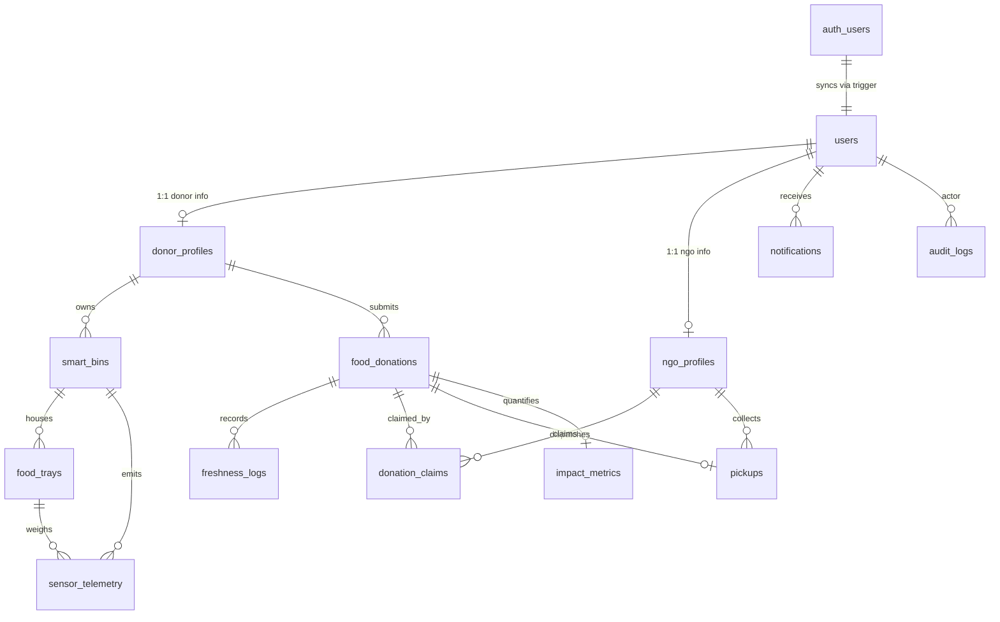

# 📑 Implementation Decisions & Engineering Specifications
## AI + IoT Smart Food Waste Monitoring & Redistribution System (**FoodTrust**)

**Document:** `IMPLEMENTATION_DECISIONS.md`  
**Author:** Lead Backend Engineer  
**Date:** September 2026  
**Status:** Authoritative Implementation Blueprint  
**Primary References:** `ARCHITECTURE.md`, `DEVELOPMENT_PLAN.md`, `ARCHITECTURE_REVIEW.md`

---

## 1. Core Architecture Decisions

### 1.1 Stack Lockdown
- **Framework:** Next.js (App Router, latest stable release) with TypeScript (`strict: true`).
- **Backend Architecture:** Modular Monolith using Next.js Route Handlers (`app/api/...`).
- **Database & Auth:** Supabase Cloud (PostgreSQL 15+, PostGIS spatial extensions, Supabase Auth with JWT).
- **Realtime & Storage:** Supabase Realtime (WebSocket channels) and Supabase Storage (for delivery proof photos).
- **Validation:** Zod schemas applied as the primary defensive barrier on all incoming API requests.
- **Express Prohibition:** Express is **not required** and will **not be added**, as Next.js Route Handlers provide native, high-performance Node.js runtime execution with complete streaming, middleware, and request/response controls.

### 1.2 Frontend Coexistence & Zero-Overwrite Guarantee
- The existing 10 static HTML files, `CSS/style.css`, `js/script.js`, and `assets/logo2.png` will be retained and served via `public/`.
- No existing HTML view will be converted to a React component or rewritten during the backend implementation.
- All new backend capabilities will be delivered as pure RESTful API endpoints (`/api/...`) that existing client scripts can consume via standard `fetch()`.

---

## 2. Database Decisions & Entity Specifications



### 2.1 User Synchronization (`auth.users` $\rightarrow$ `public.users`)
- **Decision:** Use a transactional PostgreSQL trigger function `handle_new_user()` executed `AFTER INSERT ON auth.users`.
- **Rationale:** Prevents orphan accounts or split-brain states if a client-side network error occurs between Supabase Auth signup and profile row creation.

### 2.2 Roles & Enums
- `user_role_enum`: `'DONOR'`, `'NGO'`, `'ADMIN'`, `'SUPER_ADMIN'`, `'DEVICE'`
- `user_status_enum`: `'ACTIVE'`, `'PENDING'`, `'SUSPENDED'`
- `food_category_enum`: `'COOKED_MEALS'`, `'VEGETABLES'`, `'FRUITS'`, `'BAKERY'`, `'DAIRY'`
- `freshness_status_enum`: `'FRESH'`, `'MODERATE'`, `'CRITICAL'`, `'EXPIRED'`
- `risk_level_enum`: `'LOW'`, `'MODERATE'`, `'HIGH'`, `'CRITICAL'`
- `donation_status_enum`: `'AVAILABLE'`, `'RESERVED'`, `'CLAIMED'`, `'PICKUP_IN_PROGRESS'`, `'PICKED_UP'`, `'DELIVERED'`, `'CANCELLED'`, `'EXPIRED'`
- `bin_status_enum`: `'ONLINE'`, `'OFFLINE'`, `'MAINTENANCE'`, `'ALERT'`
- `pickup_status_enum`: `'SCHEDULED'`, `'EN_ROUTE'`, `'ARRIVED'`, `'PICKED_UP'`, `'DELIVERED'`, `'FAILED'`

### 2.3 PostGIS Spatial Structure
- `donor_profiles`, `ngo_profiles`, and `food_donations` will include:
  - `latitude`: `DOUBLE PRECISION NOT NULL`
  - `longitude`: `DOUBLE PRECISION NOT NULL`
  - `location`: `GEOGRAPHY(Point, 4326) GENERATED ALWAYS AS (ST_SetSRID(ST_MakePoint(longitude, latitude), 4326)) STORED`
- **Spatial Index:** `CREATE INDEX idx_ngo_location ON ngo_profiles USING GIST(location);`
- **Spatial Queries:**
  ```sql
  -- Find verified NGOs within their operational radius of a donation point
  SELECT id, organization_name, ST_Distance(location, donation_geo) AS distance_meters
  FROM ngo_profiles
  WHERE verification_status = 'VERIFIED'
    AND ST_DWithin(location, donation_geo, operational_radius_km * 1000)
  ORDER BY distance_meters ASC;
  ```

### 2.4 Race-Condition Prevention on Claims
- **Decision:** Enforce both a **partial unique index** and **database-level row locking**:
  1. `CREATE UNIQUE INDEX idx_single_active_claim ON donation_claims (donation_id) WHERE status IN ('APPROVED', 'PENDING');`
  2. The claim route handler executes inside a Supabase/PostgreSQL transaction with `SELECT * FROM food_donations WHERE id = $1 FOR UPDATE`.

---

## 3. Decision-Support Terminology & Metrics Modeling

### 3.1 Freshness Evaluation Protocol (Special Requirement A)
- **Clear Demarcation:** The system is explicitly designed as a **decision-support heuristic tool** that models spoilage kinetics based on ambient sensor telemetry.
- **Forbidden Language:** No API response, schema, or UI copy will claim food is *"certified safe to eat"* or *"medically validated"*.
- **Standardized Field Names:**
  - `freshness_score` (Integer, 0 to 100)
  - `freshness_status` (`FRESH`, `MODERATE`, `CRITICAL`, `EXPIRED`)
  - `risk_level` (`LOW`, `MODERATE`, `HIGH`, `CRITICAL`)
  - `estimated_shelf_life_hours` (Numeric, 1 decimal place)
- **Mandatory Response Envelope:**
  ```json
  "freshness_evaluation": {
    "freshness_score": 88,
    "freshness_status": "FRESH",
    "risk_level": "LOW",
    "estimated_shelf_life_hours": 14.5,
    "disclaimer": "Decision-support indicator based on ambient telemetry; not a certified substitute for food safety testing."
  }
  ```

### 3.2 Impact Estimation Protocol (Special Requirement B)
- **Formulas Preserved:**
  $$\text{estimated\_meals\_served} = \text{ROUND}\left(\frac{\text{weight\_kg}}{0.4}\right)$$
  $$\text{estimated\_co2\_offset\_kg} = \text{weight\_kg} \times 2.5$$
- **Engineering Representation:**
  - Both multipliers are stored in a centralized configuration file (`lib/config/constants.ts`):
    ```typescript
    export const IMPACT_CONFIG = {
      KG_PER_MEAL: 0.4,       // Standard FAO portion estimate
      CO2_KG_PER_FOOD_KG: 2.5, // UNEP Food Waste Index conversion factor
      IS_ESTIMATE: true
    } as const;
    ```
  - The API returns both the calculated values and the methodology descriptor so frontend callers can display clear estimate tooltips.

---

## 4. Hardware Unit Separation & IoT Telemetry Contract

### 4.1 Physical Unit Separation
```
+--------------------------------------------------------------+
| 1. FOOD HANDLING UNIT (Interior Sanitary Compartment)        |
|    - Food-grade Removable Trays (Stainless Steel / PETG)     |
|    - Tray Weighing Sub-assemblies                            |
|    - Load Cells (Mounts below trays)                         |
|    - DHT22 (Temperature & Humidity, sealed probe)            |
|    - MQ-135 (VOC & Spoilage gas sensor, splash-guarded)     |
+--------------------------------------------------------------+
                               ||
         Hermetic Wire Pass-through (Food-grade Silicone)
                               ||
+--------------------------------------------------------------+
| 2. ELECTRONICS UNIT (Exterior Lower Compartment)             |
|    - HX711 24-bit ADC Modules (Amplifies load cell mV)       |
|    - ESP32 Microcontroller (Dual-core Wi-Fi/BLE)            |
|    - 5V DC Power Supply & Thermal Fuses                      |
|    - Calibration/Status LEDs and Buzzer                      |
+--------------------------------------------------------------+
```

### 4.2 Exact Telemetry JSON Contract (ESP32 Simulation / Postman)

#### Endpoint: `POST /api/iot/telemetry`
**Headers:**
- `Content-Type: application/json`
- `x-bin-id: BIN-DELHI-001`
- `x-device-token: dt_sec_9f8e7d6c5b4a3120`

**Request Payload:**
```json
{
  "binCode": "BIN-DELHI-001",
  "timestamp": "2026-09-30T17:45:00.000Z",
  "ambient": {
    "temperatureC": 23.5,
    "humidityPct": 56.0,
    "vocGasPpm": 120.5
  },
  "system": {
    "lidOpen": false,
    "batteryPct": 95,
    "firmwareVersion": "1.0.4"
  },
  "trays": [
    {
      "trayNumber": 1,
      "category": "COOKED_MEALS",
      "rawWeightKg": 15.20,
      "tareWeightKg": 2.50,
      "netWeightKg": 12.70
    },
    {
      "trayNumber": 2,
      "category": "VEGETABLES",
      "rawWeightKg": 6.80,
      "tareWeightKg": 2.50,
      "netWeightKg": 4.30
    }
  ]
}
```

**Success Response (HTTP 200 OK):**
```json
{
  "success": true,
  "message": "Telemetry processed successfully",
  "data": {
    "binCode": "BIN-DELHI-001",
    "recordedAt": "2026-09-30T17:45:00.000Z",
    "evaluations": [
      {
        "trayNumber": 1,
        "category": "COOKED_MEALS",
        "netWeightKg": 12.70,
        "freshnessScore": 92,
        "freshnessStatus": "FRESH",
        "riskLevel": "LOW",
        "estimatedShelfLifeHours": 6.0,
        "disclaimer": "Decision-support indicator based on ambient telemetry; not a certified substitute for food safety testing."
      },
      {
        "trayNumber": 2,
        "category": "VEGETABLES",
        "netWeightKg": 4.30,
        "freshnessScore": 86,
        "freshnessStatus": "FRESH",
        "riskLevel": "LOW",
        "estimatedShelfLifeHours": 18.0,
        "disclaimer": "Decision-support indicator based on ambient telemetry; not a certified substitute for food safety testing."
      }
    ]
  },
  "timestamp": "2026-09-30T17:45:00.085Z"
}
```

---

## 5. Security & Access Control Decisions

1. **Row Level Security (RLS) Policy Strategy:**
   - Helper function `get_current_user_role()` defined with `SECURITY DEFINER` on PostgreSQL to eliminate recursive policy traps.
   - Donors can only `SELECT`, `INSERT`, `UPDATE` rows where `donor_id` matches their own profile.
   - NGOs can only claim donations in `'AVAILABLE'` status.
   - Volunteers can only view pickups assigned to their NGO organization.
2. **Device Token Verification:**
   - ESP32 hardware tokens are stored as salted SHA-256 hashes (`api_key_hash`) in `smart_bins`.
   - Clear-text tokens are never stored in the database.
   - Verification occurs in the Next.js Route Handler before invoking backend services.
3. **Pickup OTP Verification:**
   - Generated as a 6-digit cryptographically random numeric string.
   - Hashed using SHA-256 before storage in `pickups.otp_code_hash`.
   - Max 3 verification attempts allowed before automatic invalidation.
4. **Service Role Isolation:**
   - `SUPABASE_SERVICE_ROLE_KEY` is loaded exclusively in `lib/supabase/admin.ts`.
   - No client component or public bundle will have access to this client.

---

## 6. Implementation Sequence & Testing Strategy

### 6.1 Database Implementation Order (Phase 1)
1. Extensions: `uuid-ossp`, `postgis`
2. Custom ENUM types
3. Core tables: `users`, `donor_profiles`, `ngo_profiles`
4. IoT hardware tables: `smart_bins`, `food_trays`, `sensor_telemetry`
5. Donation & Logistics tables: `food_donations`, `donation_claims`, `pickups`, `freshness_logs`
6. Analytics & Audit tables: `notifications`, `impact_metrics`, `audit_logs`
7. Constraints & Indexes: PostGIS GIST indexes, unique claim locks, telemetry timestamps
8. Trigger functions: `handle_new_user()`, `update_timestamp()`
9. RLS Policies: Table-by-table granular rules
10. Seed Data: Reproducible initial donors, NGOs, bins, and demo telemetry

### 6.2 API Implementation Order (Phases 2 – 8)
1. `/api/health` — System and latency check
2. `/api/auth/*` — Register, login, logout, me
3. `/api/donors/*` & `/api/ngos/*` — Profiles and verification
4. `/api/iot/*` — Telemetry ingest, heartbeat, bins, tray tare
5. `/api/donations/*` — Active listings, submit, claim, freshness, match
6. `/api/pickups/*` — Scheduling, generate-otp, verify-otp, complete
7. `/api/notifications/*` — User notification queue
8. `/api/analytics/*` — Overview, donor, NGO, admin KPIs
9. `/api/admin/*` — User status controls, audit log search, config

### 6.3 Hardware Integration Order (Phases 3 – 5)
1. **Mock Ingestion Testing (Postman / cURL):** Validate `/api/iot/telemetry` with realistic simulated JSON payloads.
2. **ESP32 Firmware HTTPS Client:** Implement TLS connection to Next.js route using standard WiFiClientSecure with `x-bin-id` and `x-device-token`.
3. **Sensor Calibration:** Calibrate HX711 tare offsets with empty food trays and calibrate temperature/gas sensor baselines.
4. **End-to-End Hardware Test:** Place physical weight on Food Handling Unit tray $\rightarrow$ ESP32 sends telemetry $\rightarrow$ Backend calculates freshness $\rightarrow$ Generates donation $\rightarrow$ NGO dashboard updates via Realtime.

### 6.4 Testing Strategy
- **Unit Testing:** Jest/Vitest for `freshness.service.ts` (10 environmental decay vectors) and `matching.service.ts` (distance calculations).
- **API Integration Testing:** Exportable Postman Collection with automated test scripts covering all 7 API groups.
- **Concurrency Testing:** Automated race-condition tests simulating simultaneous NGO claims.

---

## 7. Scope for Phase 0 (Next Immediate Step)

Phase 0 sets up the backend foundation without modifying business logic or database state:
1. Initialize `package.json` with dependencies (`next`, `react`, `react-dom`, `@supabase/supabase-js`, `@supabase/ssr`, `zod`, `typescript`, `@types/node`).
2. Create `tsconfig.json` with `@/*` path mapping.
3. Configure `next.config.ts` to ensure public static HTML/CSS/JS files are served cleanly.
4. Create `.env.example` with documented environment keys.
5. Create directory skeleton (`app/api/health`, `lib/services/`, `lib/supabase/`, `lib/validation/`, `lib/utils/`, `types/`, `supabase/migrations/`).
6. Implement `GET /api/health` and uniform API response helper (`lib/utils/api-response.ts`).
7. Verify existing frontend HTML files continue to open cleanly.
